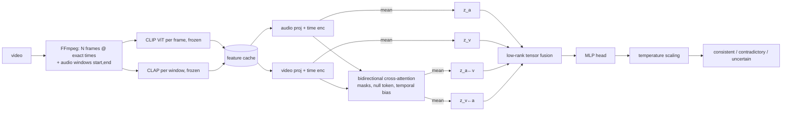

# Cross-Attention Tensor Fusion for Detecting Audio-Visual Semantic Contradictions in Short-Form Video

A reproducible PyTorch research codebase that predicts whether the audio and the visual content of
a short video are **consistent** or **contradictory** (with an abstaining **uncertain** output),
using frozen pretrained encoders, timestamp-aware bidirectional cross-attention and low-rank
tensor fusion, plus the baselines and ablations needed to test whether those components help.

> **Status (honest summary).** The full pipeline (data tooling, model, training, evaluation,
> dashboard, notebooks) is implemented and tested on CPU. The only experiments run so far
> are on a **fully synthetic sanity benchmark**.
> **No real-data result exists yet**, so there is currently no evidence for or against the
> research hypothesis on real videos. Real-data runs need a dataset you obtain under its terms
> and, practically, a GPU.

## 1. Problem statement

Input: a short video (frames + audio waveform). Output: a structured prediction
(`label`, contradiction/consistency probability, evidence timestamps, confidence, warnings).
Example targets: narration says "the car is red" over a blue car; the soundtrack is a violin over a
visible piano. The model must not treat every mismatch (off-screen sound, background music, noise,
sarcasm, slight A/V offset) as a contradiction - which is why `uncertain` exists and why the
benchmark design matters more than the architecture.

**Hypothesis (to test, not assumed):** learning interactions between audio and visual
representations via cross-attention and multimodal tensor fusion outperforms unimodal models and
concatenation fusion on a suitable contradiction benchmark.

## 2. Motivation and intended applications

Content-quality checks for short-form video (mismatched dubbing, wrong stock audio, mislabeled
clips), dataset curation (finding broken audio-visual pairs), and research on multimodal
consistency. **Not** a misinformation, deception or deepfake detector.

## 3. Features

* FFmpeg decoding (bundled binary via `imageio-ffmpeg`, no system install needed), exact frame
  timestamps, windowed audio with (start, end) times, silence/missing-stream handling.
* Frozen CLIP (vision) and CLAP (audio) encoders with an on-disk feature cache keyed by a hash of
  every preprocessing/encoder setting; optional Whisper transcripts as evidence.
* Bidirectional audio↔video cross-attention with padding masks, a learned null token, sinusoidal
  time encodings and a learnable temporal-proximity attention bias.
* Low-rank multimodal tensor fusion over {audio, video, audio←video, video←audio}; concat baseline.
* Ablation switches and presets; majority and projected-similarity baselines; multi-seed suite that saves the best model (chosen on validation).
* Training: AMP, gradient accumulation/clipping, warmup + cosine/linear schedules, early stopping,
  best/periodic/last checkpoints, resume, NaN guards, graceful Ctrl-C, TensorBoard + JSONL logs.
* Evaluation: accuracy, macro/per-class P/R/F1, confusion matrix, ROC-AUC, PR-AUC, ECE, Brier,
  bootstrap CI, latency, parameter count, peak GPU memory; temperature scaling fitted on val.
* Dataset tooling: manifest schema, audit (missing/corrupt/duplicate/near-duplicate files, label
  conflicts, leakage), union-find source grouping, group-stratified splits, manifest hashing.
* Streamlit dashboard for testing a model on uploaded videos (with a model-comparison mode); one Kaggle notebook that trains and selects the best model on AVHBench.

## 4. Architecture




## 5. Model design and fusion equations

Cross-attention (per layer, both directions from the previous layer's states, pre-LN residual):

```
a' = a + MHA(Q = LN(a), K = V = LN([null_v ; v]), key_mask_v, B)        B_ij = -(t_i^a - t_j^v)^2 / (2σ^2)
v' = v + MHA(Q = LN(v), K = V = LN([null_a ; a]), key_mask_a, Bᵀ)
x'' = x' + FFN(LN(x'))
```

Low-rank tensor fusion with z̃_m = [LN(z_m); 1] and M = 4 inputs:

```
h = Σ_{r=1..R} λ_r ⊙_{m=1..M} (z̃_mᵀ W_m^{(r)}) + b        ≡ rank-R factorisation of  W · vec(z̃_1 ⊗ z̃_2 ⊗ z̃_3 ⊗ z̃_4)
params = R · Σ_m (d_m + 1) · d_out + R + d_out              (dense equivalent: Π_m (d_m + 1) · d_out)
```

At default sizes (D = 256, d_out = 128, R = 4) the fusion layer has 526,468 weights versus
≈5.6·10¹¹ for the dense tensor. Prediction head: MLP → 2 logits, cross-entropy.

## 6. Dataset sources and licenses

No public dataset with genuine audio-visual *semantic-contradiction* labels was found. Summary:

| source | role | license / access |
|---|---|---|
| AVHBench AV-Matching | primary real-data proxy (yes/no correspondence, real + swapped clips) | **no license stated** in the repo - verify with authors; clips from VALOR/AudioCaps (YouTube) |
| VGGSound | construct within-conflict-group audio swaps (flagged synthetic) | annotations CC BY 4.0; videos remain uploaders' copyright; YouTube ToS applies |
| ColorTone (this repo) | fully synthetic mechanism check | generated, CC0 |

Pretrained weights: CLAP `laion/clap-htsat-unfused` is Apache-2.0. CLIP `openai/clip-vit-base-patch32`'s
model card restricts it to research use and states deployed use cases are out of scope. `openai/whisper-small` is listed as Apache-2.0 on its model card.

## 7. Dataset preparation

```bash
# synthetic sanity benchmark (no downloads; 300 clips)
python -m av_contradiction.cli.make_synthetic_benchmark --out data/synthetic_colortone --scenes 150

# AVHBench (download videos + QA json yourself from the AVHBench README, after checking terms)
python -m av_contradiction.cli.prepare_dataset avhbench --qa-json data/raw/avhbench/QA.json \
    --video-dir data/raw/avhbench/videos --out data/manifests/avhbench.csv [--group-regex '<regex>']

# VGGSound within-group swaps (clips must already be on disk)
python -m av_contradiction.cli.prepare_dataset vggsound-swap --csv data/raw/vggsound/vggsound.csv \
    --clip-dir data/raw/vggsound/clips --groups data/conflict_groups.json \
    --work-dir data/derived/vggsound --out data/manifests/vggsound_swap.csv

# any manifest you built yourself: leakage-safe group-stratified splits
python -m av_contradiction.cli.prepare_dataset split --manifest my.csv --out data/manifests/manifest.csv

# audit (exit code 1 on errors)
python -m av_contradiction.cli.audit_dataset --manifest data/manifests/avhbench.csv --root-dir . --probe --near-duplicates
```

## 8. Installation (Windows / Linux)

Python ≥ 3.10 (verified here with 3.14.5 on Windows 11).

```bash
python -m venv .venv
# Windows: .venv\Scripts\activate      Linux/macOS: source .venv/bin/activate
pip install torch --index-url https://download.pytorch.org/whl/cpu    # or the CUDA build for your driver
pip install -e ".[encoders,dashboard,logging,dev]"
python -m av_contradiction.cli.check_environment --check-network
```

FFmpeg: a system `ffmpeg` on PATH is used if present, otherwise the binary bundled with
`imageio-ffmpeg`; override with `AVC_FFMPEG` or `preprocess.ffmpeg_path`.

Pretrained weights are **never downloaded implicitly** (`encoders.local_files_only: true`). To fetch
CLIP/CLAP once (~1.2 GB) after checking disk space and licenses:

```bash
# downloads on first use, then caches under HF_HOME (needs an existing manifest)
python -m av_contradiction.cli.extract_features --set data.manifest=data/manifests/avhbench.csv     --set encoders.local_files_only=false --limit 1
```

## 9. Training on Kaggle (AVHBench)

`notebooks/kaggle_train.ipynb` runs the whole pipeline on a Kaggle GPU:

1. Push this repository to GitHub. In Kaggle, create a notebook from `kaggle_train.ipynb`
   (*File → Import Notebook*), set *Accelerator* to GPU and *Internet* to On.
2. `REPO_URL` already points at the project repo. For a private repo, add a GitHub token as the Kaggle secret `GITHUB_TOKEN`.
3. *Save Version → Save & Run All*. The notebook clones the code, downloads AVHBench from the Google
   Drive links in its README (or uses an attached Kaggle Dataset named `*avhbench*` if Drive refuses),
   builds group-safe splits, extracts CLIP + CLAP features, trains every preset over 3 seeds and
   copies the run with the best **validation** macro-F1 to `reports/avhbench/best_model/`.
4. Download `best_model.zip` from the *Output* tab, unzip it into `output/checkpoints/avhbench_best/`
   and open it in the dashboard (section 14). The zip holds `best.pt`, `calibration.json`, the test
   report and `best_model.json` (preset, seed, validation and test macro-F1). Using it locally needs
   CLIP/CLAP in the local Hugging Face cache.

Check step 4 of the notebook before trusting the split: if AVHBench's swapped clips share an id
prefix with their originals, set `GROUP_REGEX` so both land in the same split. GPU type, quotas and
session length depend on your Kaggle account.

## 10. Settings (Kaggle GPU)

There are no config files. The built-in defaults in `src/av_contradiction/config.py` are the
settings for a Kaggle GPU (T4 / P100, ~16 GB): frozen CLIP + CLAP, 16 frames, 2 s audio windows
(1 s hop), hidden size 256, 2 cross-attention layers, rank-4 tensor fusion, batch 32, AMP, 30 epochs,
lr 3e-4, early-stopping patience 6. Change any value per run with `--set`, e.g.
`--set training.epochs=50`, or pass a YAML file with `--config` to override several at once.

| if | use |
|---|---|
| CUDA out of memory | `--set hardware.profile=low_memory` (8 frames, hidden 128, batch 8 × 4) |
| a ≥ 24 GB GPU | `--set hardware.profile=experimental` |

Training on cached features needs no encoder in memory; the encoders only run during extraction
(CLIP ViT-B/32 + CLAP ≈ 1.2 GB of fp32 weights). **Peak GPU memory has not been measured** in this
repository: the development machine has no CUDA GPU. Evaluation reports `peak_gpu_memory_mb`
when run on CUDA.

## 11. Training

```bash
python -m av_contradiction.cli.extract_features
python -m av_contradiction.cli.train                       # proposed model
python -m av_contradiction.cli.train --preset concat       # a baseline
python -m av_contradiction.cli.train --resume output/checkpoints/default/last.pt
```

Checkpoints: `output/checkpoints/<experiment_name>/{best,last,interrupted}.pt` containing model,
optimizer, scheduler and AMP-scaler state, epoch/step, config (incl. preprocessing), label map,
seed, manifest SHA-256, feature hash, package versions, training-feature statistics (OOD check)
and best validation metric. Each run also writes its full settings to `config.yaml` and its
per-epoch history to `train_summary.json` next to the checkpoint; TensorBoard logs go to `output/runs/`.

## 12. Evaluation methodology

```bash
python -m av_contradiction.cli.evaluate --checkpoint output/checkpoints/default/best.pt          # test split
```

* Splits are fixed in the manifest before any model comparison; all presets use identical
  features and test samples.
* Checkpoints are selected on **validation** macro-F1; the test split is only reported.
* Temperature scaling is fitted on validation logits and applied to test; both raw and calibrated
  metrics are saved. If the temperature hits its bound (separable validation set) the result
  carries a warning and the predictor labels its probabilities uncalibrated.
* Macro-F1 is the headline metric (robust to imbalance), with a 95 % percentile bootstrap CI.
* Outputs: `output/reports/<exp>/metrics_test.json`, `predictions_test.csv`, `confusion_test.png`,
  `reliability_test.png`.

## 13. Baselines and ablations

```bash
python -m av_contradiction.cli.run_ablations --seeds 1 2 3
```

| preset | audio | video | cross-attn | fusion | alignment |
|---|---|---|---|---|---|
| `majority` | - | - | - | predicts most frequent train class | - |
| `similarity` | ✓ | ✓ | - | ridge audio→video map on consistent train clips, 1-cos score, threshold tuned on val (uncalibrated) | - |
| `audio_only` | ✓ | | | concat | timestamp |
| `video_only` | | ✓ | | concat | timestamp |
| `concat` | ✓ | ✓ | | concat | timestamp |
| `tensor_no_xattn` | ✓ | ✓ | | tensor | timestamp |
| `xattn_concat` | ✓ | ✓ | ✓ | concat | timestamp |
| `xattn_tensor_global` | ✓ | ✓ | ✓ | tensor | global |
| **`xattn_tensor` (proposed)** | ✓ | ✓ | ✓ | tensor | timestamp |

### Results

**Real data: pending.** No real-data experiment has been run.

| preset | macro-F1 | accuracy | ROC-AUC | PR-AUC | ECE |
|---|---|---|---|---|---|
| all presets | _pending_ | _pending_ | _pending_ | _pending_ | _pending_ |

**Synthetic ColorTone sanity benchmark** (mechanism check only, 60 test clips, 3 seeds, CPU).
Actual v2 numbers (test macro-F1): xattn_concat 0.994 ± 0.010, **xattn_tensor 0.978 ± 0.010**,
tensor_no_xattn 0.754 ± 0.035, concat 0.728 ± 0.083, xattn_tensor_global 0.725 ± 0.046,
similarity 0.741, audio_only 0.525 ± 0.048, video_only 0.498 ± 0.001, majority 0.333.
On this benchmark timestamp-aware cross-attention is what matters. Low-rank tensor fusion shows
**no measurable gain** over concatenation. The schedule was lengthened after a first run (v1) in which
several seeds stalled at chance (v1, 40 epochs, patience 10: xattn_tensor 0.667 ± 0.289, seeds 0.520 / 0.482 / 1.000).
v2 used 150 epochs and patience 40 for every preset, with no other change. Disclosure: the v1 *test*
numbers were visible when that change was made, so v2 is not a fully blind confirmation.

## 14. Dashboard

```bash
streamlit run src/av_contradiction/serving/dashboard.py      # from the project root
# optional: preselect a checkpoint
# Windows PowerShell: $env:AVC_CHECKPOINT="output\checkpoints\default\best.pt"
```

The dashboard is the project's only frontend. It loads a checkpoint from `output/checkpoints/`,
previews the uploaded video (types `inference.allowed_extensions`, up to `inference.max_upload_mb`),
and shows the label, score, calibration status, sampled frames with timestamps, audio windows,
transcript (if Whisper is enabled), attention links and warnings, plus metrics read from the
checkpoint's saved evaluation report. Comparison mode runs a second checkpoint (e.g. `audio_only`)
side by side. The same prediction is available as JSON from `python -m av_contradiction.cli.predict`.

## 15. Output schema (shape only; values illustrative)

```json
{
  "label": "consistent | contradictory | uncertain",
  "contradiction_probability": 0.0,
  "consistency_probability": 0.0,
  "probability_calibrated": true,
  "confidence": 0.0,
  "confidence_interpretation": "...",
  "audio_summary": null,
  "visual_summary": null,
  "evidence": {
    "frames": [{"index": 0, "timestamp_sec": 0.19}],
    "audio_windows": [{"index": 0, "start_sec": 0.0, "end_sec": 0.5, "silent": false}],
    "transcript": [{"start_sec": 0.0, "end_sec": 1.2, "text": "..."}],
    "attention_links": [{"audio_window_index": 0, "audio_time_sec": 0.25, "video_frame_index": 0,
                         "video_time_sec": 0.19, "weight": 0.0, "null_weight": 0.0}],
    "note": "attention weights are not causal explanations ..."
  },
  "warnings": ["..."],
  "duration_sec": 3.0,
  "model": {"checkpoint": "best.pt", "preset": "xattn_tensor", "calibrated": true, "...": "..."},
  "timing_ms": {"decode_ms": 0.0, "encode_ms": 0.0, "model_ms": 0.0}
}
```

`visual_summary` is always `null` (no captioner is implemented); `audio_summary` is the Whisper
transcript when transcription is enabled and its weights are cached locally.

## 16. Limitations and failure cases

Key points: correspondence labels ≠ contradiction;
synthetic negatives can carry shortcuts; frozen single-frame image encoders; sarcasm, off-screen
sound and background music are unmodelled; attention ≠ explanation; calibration does not transfer
under domain shift; the OOD warning is an unvalidated heuristic.

## 17. Reproducibility

Seeds (Python/NumPy/Torch, DataLoader generator and workers), resolved configs saved next to each
checkpoint, manifest SHA-256 and feature-cache hash stored in checkpoints and checked at
evaluation, package versions recorded, deterministic group splits, and machine-readable metrics
(JSON/CSV). Plots are generated only from saved outputs.

## 18. Troubleshooting

| symptom | fix |
|---|---|
| `CLIP weights ... not in local cache` | download deliberately once with `--set encoders.local_files_only=false`, or set `HF_HOME` to a populated cache |
| `No cached features found` | run `python -m av_contradiction.cli.extract_features` with the **same** config (cache key = preprocessing + encoder settings) |
| `encoders.audio=clap requires preprocess.audio_sample_rate=48000` | CLAP needs 48 kHz; the handcrafted encoder works at any rate |
| FFmpeg not found | `pip install imageio-ffmpeg` or set `AVC_FFMPEG` |
| CUDA OOM | `--set hardware.profile=low_memory`, lower `training.batch_size`, raise `grad_accum_steps` |
| val metric stuck at chance then early stop | increase `training.epochs` / `early_stopping_patience` (observed on the synthetic benchmark) |
| first FFmpeg call very slow on Windows | antivirus scanning the bundled binary; subsequent calls are fast |

## 19. Ethics and privacy

Uploaded media are processed transiently and not logged. Respect dataset licenses and platform
terms; do not redistribute YouTube-derived videos. Outputs must not be used to label people or
content as deceptive. CLIP and CLAP carry biases from web-scale training data.

## 20. Future improvements

Real-data experiments on GPU (AVHBench, then a human-reviewed VGGSound-swap set); human annotation
of contradiction vs unrelated vs uncertain to enable a defensible three-class benchmark; video
encoders with temporal modelling (e.g. VideoMAE); speech-text contradiction via transcripts + NLI as
an extra branch; contradiction localisation with its own evaluation; loudness/codec normalisation
for swap negatives; async job queue for long videos; literature review before any novelty claim.

## Repository layout

All code lives under `src/`; the top level holds only the README, packaging, notebooks and
generated data.

```
src/
  av_contradiction/
    config.py   data/ (manifest, preprocessing, validation, splits, features, dataset, adapters, synthetic)
    models/ (video_encoder, audio_encoder, alignment, cross_attention, tensor_fusion, classifier, baselines)
    training/ (trainer, losses, metrics, checkpointing)   evaluation/ (evaluate, ablations, reporting)
    inference/ (predictor, schemas, transcription)        utils/ (device, logging, reproducibility)
    cli/      check_environment, audit_dataset, prepare_dataset, make_synthetic_benchmark,
              extract_features, train, evaluate, run_ablations, predict   (python -m av_contradiction.cli.<name>)
    serving/  dashboard (Streamlit)
  tests/
notebooks/kaggle_train.ipynb
data/                                      datasets, created when you generate or prepare one (git-ignored)
output/   cache/  checkpoints/  reports/  runs/   (everything the pipeline generates, git-ignored)
```

Run commands from the project root after `pip install -e .`; default paths (`data/`, `output/`) are relative to it.

## Tests

```bash
pytest                    # unit + miniature end-to-end pipeline, CPU only, no downloads
pytest -m integration     # real CLIP/CLAP (needs weights in the local HF cache)
ruff check src
```
