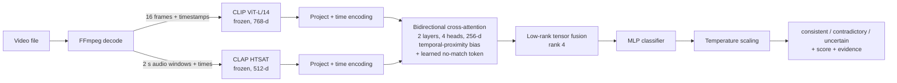

<div align="center">

# Cross-Attention Tensor Fusion for Detecting Audio-Visual Semantic Contradictions

**Give it a short video and it tells you whether what you _hear_ matches what you _see_.**

A violin playing over a visible guitar, or a narrator describing a red car over a blue one: the model
looks at sampled frames and audio windows together and returns `consistent`, `contradictory` or
`uncertain`, a calibrated score, and model attention signals for inspection.

[](https://www.python.org/)
[](https://pytorch.org/)
[](https://huggingface.co/docs/transformers)
[](https://streamlit.io/)
[](https://www.kaggle.com/)
[](https://ffmpeg.org/)
[](models)
[](#results)
[](https://docs.astral.sh/ruff/)

</div>

## Table of contents

- [Features](#features)
- [How it works](#how-it-works)
- [Architecture](#architecture)
- [Tech stack](#tech-stack)
- [Project structure](#project-structure)
- [Installation](#installation)
- [Quick start: run the trained model](#quick-start-run-the-trained-model)
  - [Streamlit dashboard](#streamlit-dashboard)
  - [Command line](#command-line)
  - [Python API](#python-api)
- [Hardware and speed](#hardware-and-speed)
- [Dataset: AVID-Bench subset](#dataset-avid-bench-subset)
- [Training](#training)
  - [On Kaggle (free GPU, recommended)](#on-kaggle-free-gpu-recommended)
  - [On a laptop](#on-a-laptop)
  - [Audio-swap benchmark (no audio shortcut)](#audio-swap-benchmark-no-audio-shortcut)
  - [On your own data](#on-your-own-data)
- [Model variants](#model-variants)
- [Results](#results)
- [Configuration](#configuration)
- [Where everything lives](#where-everything-lives)
- [Development](#development)
- [Limitations](#limitations)
- [Third-party licenses and responsible use](#third-party-licenses-and-responsible-use)

## Features

- **Video in, verdict out.** Upload an `.mp4/.mov/.mkv/.webm/.avi` (up to 60 s, 100 MB) and get
  `consistent` / `contradictory` / `uncertain` with a temperature-calibrated contradiction score.
- **Time-aware fusion.** Bidirectional audio↔video cross-attention with timestamp encodings, a
  temporal-proximity bias and a learned "no visual match" token, followed by low-rank tensor fusion.
- **Evidence, not just a label.** The sampled frames with timestamps, every audio window, model
  attention signals, and human-readable similarity hints.
- **Streamlit analytics dashboard** with an upload-first flow: verdict, input preprocessing, what is
  seen/heard, model signals, technical feature patterns, and dataset information.
- **Text view (media and text analytics).** CLIP and CLAP were trained on captions, so their features
  can be read as words: zero-shot tags for what is **seen** in the frames and **heard** in the audio,
  relative similarity hints for what is **seen** and **heard**, and an optional **Whisper speech transcript**
  with keywords compared against the frames. These are explanations only; they do not change the verdict.
- **One trained model included** ([`models/`](models)): clone and predict, no training needed.
- **Cheap training.** The large encoders are frozen; their features are computed once and cached, so
  only a ~3 M-parameter fusion model is trained, in minutes.
- **One-click Kaggle notebook** that extracts features, trains 7 variants × 3 seeds plus baselines,
  picks the best on validation and exports `best_model.zip`.
- **Honest evaluation.** Leakage-safe group splits, model selection on validation only, a single test
  report with bootstrap confidence intervals, unimodal baselines to expose shortcuts, ECE calibration.
- **Fully offline after setup.** Weights are downloaded once; FFmpeg ships with `imageio-ffmpeg`.
- **Reproducible data.** A checksummed manifest of the exact 2,600 AVID-Bench clips, with resumable
  download and verification tools.

## How it works

1. **Decode** the video with FFmpeg: 16 frames at exact timestamps, and the audio as 2 s windows with
   a 1 s hop.
2. **Encode** each frame with frozen **CLIP ViT-L/14** and each audio window with frozen **CLAP**
   (`laion/larger_clap_general`).
3. **Fuse.** Audio tokens attend to video tokens and vice versa, both knowing *when* each token
   happens. Audio with no matching visual evidence can attend to a learned "no match" token.
4. **Combine** the two pooled streams with low-rank tensor fusion (multiplicative interactions)
   and classify.
5. **Calibrate and decide.** The score is temperature-scaled on validation data; scores between
   0.35 and 0.65 are reported as `uncertain`.

## Architecture



| component | details | trained? |
|---|---|---|
| Frame encoder | CLIP ViT-L/14 image tower (`openai/clip-vit-large-patch14`), 768-d per frame | frozen |
| Audio encoder | CLAP HTSAT-base (`laion/larger_clap_general`), 512-d per 2 s window | frozen |
| Cross-attention | 2 layers, 4 heads, hidden 256, sinusoidal time encodings, Gaussian temporal bias (σ = 1 s), null token | ✓ |
| Fusion | low-rank tensor fusion (rank 4, 128-d) or concatenation | ✓ |
| Classifier | MLP (128 hidden), 2 classes | ✓ |
| Calibration | one temperature fitted on validation | fitted |

Training: AdamW (lr 3e-4, weight decay 0.01), warm-up + cosine schedule, mixed precision, up to 60
epochs with early stopping (patience 15) on validation macro-F1.

## Tech stack

| area | tools |
|---|---|
| Language | Python 3.10+ |
| Deep learning | PyTorch 2.2+ |
| Pretrained encoders | Hugging Face Transformers (CLIP, CLAP), safetensors |
| Text analytics | CLIP / CLAP text towers (zero-shot tags), Whisper speech-to-text, keyword extraction |
| Media | FFmpeg via `imageio-ffmpeg` (no system install needed) |
| Evaluation | scikit-learn, NumPy, Matplotlib |
| Config and schemas | dataclasses + YAML (`--config`, `--set key=value`), Pydantic |
| UI | Streamlit |
| Training compute | Kaggle Notebooks (2× T4, free tier) |
| Dataset download | ModelScope SDK (official AVID-Bench host) |
| Quality | pytest, ruff |

## Project structure

```
.
├── models/                   # trained model shipped with the repo
│   └── avid/                 #   edited-audio detector, trained on AVID-Bench
├── results/                  # benchmark tables of the Kaggle runs (shown in the dashboard)
├── manifests/                # AVID subset manifest (CSV) and documentation
├── notebooks/
│   ├── kaggle_train.ipynb    # end-to-end training on Kaggle (AVID subset)
│   └── kaggle_swap.ipynb     # audio-swap benchmark: natural audio, no single-modality shortcut
├── src/
│   ├── av_contradiction/
│   │   ├── config.py         # every setting, with defaults
│   │   ├── data/             # decoding, manifests, splits, feature cache, AVID/AVHBench/VGGSound adapters
│   │   ├── models/           # encoders, cross-attention, tensor fusion, classifier, baselines
│   │   ├── training/         # trainer (AMP, early stopping, checkpoints)
│   │   ├── evaluation/       # metrics, calibration, ablations, best-model export
│   │   ├── inference/        # Predictor: video file -> PredictionResult; text view (tags, transcript)
│   │   ├── serving/          # Streamlit dashboard
│   │   ├── cli/              # all command-line entry points
│   │   └── utils/
│   └── tests/                # CPU-only unit + end-to-end tests
├── pyproject.toml
└── README.md
```

## Installation

Requirements: Python 3.10+, ~3 GB of disk for the encoder weights, and optionally an NVIDIA GPU.

```bash
git clone https://github.com/adhvaith267/Cross-Attention-Tensor-Fusion-for-Detecting-Audio-Visual-Semantic-Contradictions-in-Short-Form-Video.git
cd Cross-Attention-Tensor-Fusion-for-Detecting-Audio-Visual-Semantic-Contradictions-in-Short-Form-Video

python -m venv .venv
.venv\Scripts\activate                 # Windows
# source .venv/bin/activate            # Linux / macOS
```

Install PyTorch **first**, matching your hardware:

```bash
# NVIDIA GPU (e.g. RTX 4050): pick the CUDA command for your system at https://pytorch.org/get-started/locally/
pip install torch --index-url https://download.pytorch.org/whl/cu128
# CPU only
pip install torch
```

Then the project, the encoder weights (one-off, ~2.5 GB) and a self-check:

```bash
pip install -e ".[encoders,dashboard]"          # add ,dev for tests and ruff; ,avid to download the dataset
python -m av_contradiction.cli.download_encoders   # add --asr for the dashboard's speech transcript (~290 MB)
python -m av_contradiction.cli.check_environment   # Python, torch, CUDA/GPU, FFmpeg, cached weights
```

After this everything runs offline.

## Quick start: run the trained model

### Streamlit dashboard

```bash
streamlit run src/av_contradiction/serving/dashboard.py
```

Open the URL it prints (usually <http://localhost:8501>). Upload a short video and press
**Analyze**. The speech transcript runs automatically when the Whisper weights are present
(`download_encoders --asr`).

| tab | what it shows |
|---|---|
| **Overview** | the uploaded filename, duration, verdict, calibrated contradiction score, confidence, warnings, and a plain-language summary |
| **Input & preprocessing** | the decoding settings, sampled frames, timestamps, waveform, audio-window loudness, and silence flags from the uploaded video |
| **What is seen/heard** | CLIP/CLAP similarity hints, the optional Whisper transcript, keywords, visual similarity checks, and tags over time |
| **Model signals** | the selected model's architecture, parameters, fusion configuration, top attention signals, and attention heatmap for the uploaded video |
| **Feature patterns** | encoder outputs, frame/audio similarity heatmaps, and optional PCA diagnostics; intended for technical inspection |
| **Dataset** | training-data split and label summaries; this is the only section available before a video is uploaded |

**Text mining in detail:**

| part | how it works |
|---|---|
| Seen in the frames | the CLIP frame features compared with captions such as *"a photo of a whale"* for ~145 everyday concepts; these are relative similarity hints, not object-detection confidence |
| Heard in the audio | the CLAP audio features compared with captions such as *"the sound of a boat engine"* for ~100 sounds; these are similarity hints, not guaranteed sound identifications |
| Does the visual content resemble what was heard or said? | each heard sound and transcript keyword is compared with the frames using CLIP; an off-screen source can still be valid |
| Transcript | speech-to-text with Whisper (`openai/whisper-base`), then keyword extraction (stopwords removed, word counts) |
| Seen and heard over time | the top concept for every frame and every audio window |

Example from the AVID test set (injected audio): seen *a whale, a boat, ocean waves*; heard *a woman
speaking*. For a make-up tutorial with contradicting narration, Whisper's transcript reads *"take a
bright blue eyeshadow and apply it all over your cheeks"* while the frames show an orange eye look.
The transcript needs the Whisper weights once: `python -m av_contradiction.cli.download_encoders --asr`.

### Command line

```bash
python -m av_contradiction.cli.predict --video clip.mp4 --checkpoint models/avid/best.pt
python -m av_contradiction.cli.predict --video clip.mp4 --checkpoint models/avid/best.pt --device cuda --out pred.json
```

Output (shortened):

```json
{
  "label": "consistent",
  "contradiction_probability": 0.042,
  "probability_calibrated": true,
  "confidence": 0.958,
  "evidence": {"frames": [{"index": 0, "timestamp_sec": 0.37}, "..."], "audio_windows": ["..."], "attention_links": ["..."]},
  "warnings": []
}
```

### Python API

```python
from av_contradiction.inference.predictor import Predictor

predictor = Predictor("models/avid/best.pt", device="auto")
result = predictor.predict("clip.mp4")
print(result.label, round(result.contradiction_probability, 3))
```

## Hardware and speed

| where | what it is used for | speed |
|---|---|---|
| Laptop with NVIDIA GPU (e.g. RTX 4050, 6 GB) | inference, dashboard | a few seconds per video, mostly decoding (estimate, not yet measured); the encoders need ~1 GB VRAM in fp16 |
| Laptop, CPU only | inference, dashboard, small experiments | ~20 s per video (measured) |
| Kaggle 2× T4 | full training | 2 h 54 min for 2,600 clips, see [below](#on-kaggle-free-gpu-recommended) |

The released model was trained with CLIP ViT-L/14 + CLAP features, so inference must use the same
encoders; `predict` and the dashboard read them from the checkpoint automatically.

## Dataset: AVID-Bench subset

[`manifests/avid_subset.csv`](manifests/avid_subset.csv) lists a verified 4.9 GB subset of
[AVID-Bench](https://github.com/czx1220/AVID-bench):

- **2,600 clips = 1,300 matched pairs**: the same clip with its original audio (`consistent`) and with
  audio injected by the AVID authors (`contradictory`). Because both clips of a pair have identical
  video, the visuals alone cannot predict the label.
- **5 semantic injection types**, balanced: semantic divergence, emotion mismatch, background
  conflict, background sound, voice identity.
- **One pair per source video** and **leakage-safe splits**: train 2,000 / val 300 / test 300 clips;
  test comes only from AVID's official test split.
- Every file checked: SHA-256, decodable audio and video, labels re-checked against the official
  annotations.

Full details: [`manifests/AVID_SUBSET.md`](manifests/AVID_SUBSET.md). To download it (no account
needed):

```bash
pip install -e ".[avid]"
python -m av_contradiction.cli.prepare_avid download   # exactly the manifest's files into data/avid/ (resumable, checksummed)
python -m av_contradiction.cli.prepare_avid verify     # decode + label + leakage checks
```

The videos are YouTube-derived, so they are never committed to this repository.

## Training

You only need this to train your own model; the trained ones are already in `models/`.

### On Kaggle (free GPU, recommended)

1. **Upload the videos once.** Download the subset locally (above) and zip `data/avid/` with the
   command in [`AVID_SUBSET.md`](manifests/AVID_SUBSET.md#use-on-kaggle). On kaggle.com:
   *Datasets → New Dataset*, upload the zip, name it e.g. `avid-subset`, keep it **private**, and wait
   until Kaggle has finished processing it.
2. **Create the notebook.** *Code → New Notebook → File → Import Notebook*:
   [`notebooks/kaggle_train.ipynb`](notebooks/kaggle_train.ipynb). In the right panel, *Add Input* →
   your `avid-subset` dataset. *Settings*: Accelerator **GPU T4 ×2**, Internet **On**.
3. **Run it** with *Save Version → Save & Run All*. This runs on Kaggle's servers, so you can close
   the browser. The notebook clones this repo, checks the dataset, extracts CLIP + CLAP features,
   trains every variant over 3 seeds, picks the best on **validation** macro-F1, reports it once on
   **test**, and writes `best_model.zip` to the *Output* tab.
4. **Bring the model home.** Unzip `best_model.zip` into `models/<name>/` and commit it
   (see [`models/README.md`](models/README.md)).

Measured on the AVID subset (2,600 clips, 2× T4), well within the free tier (~30 GPU-h/week, 12 h
per session):

| step | time | notes |
|---|---|---|
| clone, install, dataset check | 1 min | |
| audit (probes every video) | 15 min | |
| feature extraction | 2 h 19 min (~3.2 s per clip) | bound by FFmpeg decoding on Kaggle's CPUs, not the GPU; resumable |
| 7 variants × 3 seeds + baselines | 18 min | on cached features |
| **total** | **2 h 54 min** | output 1.05 GB; `best_model.zip` ≈ 12 MB |

### On a laptop

The same pipeline runs locally; with a GPU it is practical for small datasets, and on CPU feature
extraction takes ~20 s per clip.

```bash
python -m av_contradiction.cli.audit_dataset --manifest manifests/avid_subset.csv --root-dir data/avid --probe
python -m av_contradiction.cli.extract_features --set experiment_name=avid --set data.manifest=manifests/avid_subset.csv --set data.root_dir=data/avid
python -m av_contradiction.cli.run_ablations --seeds 1 2 3 --set experiment_name=avid --set data.manifest=manifests/avid_subset.csv --set data.root_dir=data/avid
```

On a CPU-only machine, `--set encoders.video_model_name=openai/clip-vit-base-patch16` is about 4×
cheaper (use it for both extraction and training).

**Offline smoke test** (CPU, a few minutes, no downloads): a synthetic colour↔tone benchmark with
parameter-free encoders, to check that everything works end to end.

```bash
python -m av_contradiction.cli.make_synthetic_benchmark --scenes 150
python -m av_contradiction.cli.extract_features --config quick.yaml
python -m av_contradiction.cli.run_ablations --config quick.yaml
```

```yaml
# quick.yaml
data: {manifest: data/manifests/synthetic_colortone.csv, root_dir: data/synthetic_colortone}
encoders: {video: handcrafted, audio: handcrafted}
preprocess: {audio_sample_rate: 16000, num_frames: 8, frame_size: 64}
```

### Audio-swap benchmark (no audio shortcut)

On AVID the contradictions are edited audio, which an audio-only model finds without the video (see
[Results](#results)). The audio-swap benchmark removes that shortcut using only AVID's 1,300
**original, unedited** clips:

- **consistent**: clip A's video with A's own audio
- **contradictory**: clip A's video with the audio of another clip B from the same split

Every audio track and every video appears exactly once in each class, so `audio_only` and
`video_only` cannot beat chance; only comparing the two can. Partners have the same number of frames
and audio windows, and a swapped clip keeps A's timeline, so length and timing give nothing away.
Clips with mostly silent audio are left out. The swaps are assembled from cached features
(`video_feature_id` / `audio_feature_id` manifest columns), so no videos are re-encoded and no
editing artefacts exist. Two pairings are built: `random` (main) and `hard` (partner audio as similar
as possible to the clip's own, e.g. speech replaced by other speech).

On Kaggle: import [`notebooks/kaggle_swap.ipynb`](notebooks/kaggle_swap.ipynb), attach the
`avid-subset` dataset and, to skip ~1 hour of feature extraction, the output of your earlier training
notebook (*Add Input → Your Work → Notebooks*); GPU on, Internet on; *Save Version → Save & Run All*.
It trains all variants over 3 seeds on the swaps, tests the best one on the hard swaps, tests the
released AVID model on both, and writes `swap_results.zip`. `SCHEDULE` in its first cell sets the
training schedule for all presets; it now defaults to a longer, gentler one (150 epochs, patience 50,
learning rate 1e-4) because the cross-attention models never left chance with the default schedule
(run 1, below). Locally, with features already cached:

```bash
python -m av_contradiction.cli.make_swaps --source manifests/avid_subset.csv --out output/avid_swap.csv --pairing random
python -m av_contradiction.cli.run_ablations --seeds 1 2 3 --set experiment_name=avid_swap --set data.manifest=output/avid_swap.csv
```

### On your own data

A manifest is a CSV with `sample_id, video_path, label` (`consistent` / `contradictory`) and
optionally `split` and `group_id`. Splits are made per group, so a clip and anything derived from it
never land in different splits. `prepare_dataset` also converts AVHBench and builds VGGSound
within-category audio swaps.

```bash
python -m av_contradiction.cli.prepare_dataset split --manifest my.csv --out data/manifests/manifest.csv
python -m av_contradiction.cli.audit_dataset --manifest data/manifests/manifest.csv --probe
python -m av_contradiction.cli.extract_features --set encoders.local_files_only=false
python -m av_contradiction.cli.run_ablations --seeds 1 2 3      # trains, evaluates, saves best_model/
```

All command-line tools:

| command | purpose |
|---|---|
| `check_environment` | report Python, torch, CUDA, FFmpeg and cached weights |
| `download_encoders` | download CLIP + CLAP weights once (`--asr`: also Whisper) |
| `prepare_avid select / download / verify` | build, fetch and verify the AVID subset |
| `prepare_dataset` | make splits; convert AVHBench; build VGGSound audio swaps |
| `make_synthetic_benchmark` | offline synthetic sanity data |
| `audit_dataset` | class balance, leakage and decodability checks |
| `make_swaps` | audio-swap manifest from cached features (natural audio, balanced per modality) |
| `extract_features` | cache frozen-encoder features |
| `train` / `evaluate` | train or evaluate one preset |
| `run_ablations` | all presets × seeds, summary table, best-model export |
| `predict` | one video → JSON |

Each is run as `python -m av_contradiction.cli.<command> --help`.

## Model variants

| preset | audio | video | cross-attention | fusion | time alignment |
|---|---|---|---|---|---|
| `majority`, `similarity` | non-neural baselines | | | | |
| `audio_only` / `video_only` | ✓ / – | – / ✓ | | concat | ✓ |
| `concat` | ✓ | ✓ | | concat | ✓ |
| `tensor_no_xattn` | ✓ | ✓ | | tensor | ✓ |
| `xattn_concat` | ✓ | ✓ | ✓ | concat | ✓ |
| `xattn_tensor_global` | ✓ | ✓ | ✓ | tensor | |
| **`xattn_tensor` (proposed)** | ✓ | ✓ | ✓ | tensor | ✓ |

## Results

**AVID-Bench subset** (test = 300 clips from AVID's official test split, 150 matched pairs; 3 seeds,
mean ± std; CLIP ViT-L/14 + CLAP features; Kaggle run of 2026-10-27):

| preset | macro-F1 | ROC-AUC | ECE | params |
|---|---|---|---|---|
| majority | 0.333 | 0.500 | – | 0 |
| similarity (CLIP·CLAP cosine) | 0.563 | 0.634 | 0.113 | 0 |
| **audio_only** | **0.960 ± 0.006** | **0.987 ± 0.002** | 0.020 | 0.31 M |
| video_only | 0.490 ± 0.014 | 0.501 ± 0.001 | 0.005 | 0.38 M |
| concat | 0.941 ± 0.008 | 0.983 ± 0.003 | 0.016 | 0.61 M |
| tensor_no_xattn | 0.943 ± 0.012 | 0.980 ± 0.003 | 0.013 | 0.81 M |
| xattn_concat | 0.946 ± 0.004 | 0.979 ± 0.002 | 0.016 | 2.79 M |
| xattn_tensor_global | 0.946 ± 0.004 | 0.980 ± 0.002 | 0.018 | 3.12 M |
| xattn_tensor (proposed) | 0.944 ± 0.005 | 0.977 ± 0.002 | 0.015 | 3.19 M |

**Released edited-audio detector** ([`models/avid/`](models/avid)), picked on validation macro-F1:
`xattn_tensor_global` seed 1, test macro-F1 **0.950** (95% bootstrap CI 0.923–0.973). Re-checked on
a CPU laptop: 29 of 30 held-out test clips correct.

What this shows:
- `video_only` is at chance, as it must be: both clips of a pair have identical video.
- **`audio_only` is the best model.** The injected audio can be recognised without looking at the
  video (editing artefacts, synthetic voices or sounds), so AVID mostly measures "was the audio
  edited?". Every audio+video model is 1–2 points *below* audio-only; cross-attention and tensor
  fusion bring no measurable gain here.
- So these numbers do **not** show that the model understands audio-visual contradictions, and they
  should not be expected to transfer to unedited real-world videos. A benchmark whose contradictions
  cannot be found from one modality alone is needed for that.

**Audio-swap benchmark** ([above](#audio-swap-benchmark-no-audio-shortcut); natural audio, no
single-modality shortcut). 1,257 original AVID clips after dropping 38 mostly-silent clips and 5
without a same-length partner; test = 288 clips (144 own audio, 144 another clip's audio); 3 seeds;
same features, presets and selection rule as above; run 1 with the default schedule; Kaggle 2× T4, 15 min:

| preset | macro-F1 | ROC-AUC | params |
|---|---|---|---|
| majority | 0.333 | 0.500 | 0 |
| similarity (ridge audio→video map + cosine, no training of the fusion model) | 0.677 | **0.747** | 0 |
| audio_only | 0.484 ± 0.017 | 0.498 ± 0.004 | 0.31 M |
| video_only | 0.489 ± 0.016 | 0.500 ± 0.000 | 0.38 M |
| **concat** | **0.684 ± 0.022** | 0.730 ± 0.028 | 0.61 M |
| tensor_no_xattn | 0.616 ± 0.040 | 0.665 ± 0.015 | 0.81 M |
| xattn_concat | 0.566 ± 0.079 | 0.603 ± 0.086 | 2.79 M |
| xattn_tensor_global | 0.630 ± 0.014 | 0.674 ± 0.022 | 3.12 M |
| xattn_tensor (proposed) | 0.424 ± 0.073 | 0.503 ± 0.003 | 3.19 M |

**Released edited-audio detector** ([`models/avid/`](models/avid)):
trained on the AVID-Bench subset and reports test macro-F1 0.950.

| model | test set | macro-F1 | ROC-AUC |
|---|---|---|---|
| best swap model (`concat` seed 3, picked on validation) | random swaps | 0.665 (95% CI 0.611–0.716) | – |
| same model | hard swaps (partner audio most similar to the clip's own) | 0.661 (95% CI 0.604–0.715) | 0.692 |
| released AVID model (`models/avid/`) | random swaps | 0.377 (accuracy 0.500) | 0.494 |
| released AVID model | hard swaps | 0.363 (accuracy 0.493) | 0.496 |

What this shows:
- **The benchmark works as designed:** `audio_only` and `video_only` sit at chance, so any score above
  0.5 comes from comparing audio with video.
- **There is a real but modest cross-modal signal:** the best models reach ~0.68 macro-F1 on natural
  audio. Hard swaps (similar-sounding partners) are about as hard as random ones.
- **The released AVID model is at chance here** (ROC-AUC 0.49): it learned to spot edited audio, not
  to compare audio with video, confirming the AVID caveat.
- **The proposed fusion does not help on this data.** Plain concatenation is best and a parameter-free
  similarity baseline is close behind (best ROC-AUC). `xattn_tensor` never left chance in any of the 3
  seeds (validation macro-F1 stayed ≤ 0.48 until early stopping), and `xattn_concat` learned in 2 of 3
  seeds only after ~20 epochs, so the cross-attention models are hard to optimise with this schedule
  and ~1,000 training pairs. Its timestamp-free variant `xattn_tensor_global` does learn (0.630). All
  learning models overfit early (validation loss rises after ~10 epochs).

**Synthetic sanity benchmark** (handcrafted encoders, 60 test clips, 3 seeds): test macro-F1 was
`xattn_concat` 0.994 ± 0.010, `xattn_tensor` 0.978 ± 0.010, `concat` 0.728, `audio_only` 0.525,
`video_only` 0.498. There, where only the audio-video pairing carries the label, timestamp-aware
cross-attention is what mattered; tensor fusion gave no measurable gain over concatenation. The
training schedule was changed after first-run test numbers had been seen, so this is not a fully
blind result.

## Configuration

Every setting lives in [`src/av_contradiction/config.py`](src/av_contradiction/config.py) and can be
overridden on any command with `--set key=value` or a YAML file passed with `--config`.

| key | default | meaning |
|---|---|---|
| `preprocess.num_frames` | 16 | frames sampled per video |
| `preprocess.audio_window_sec` / `audio_hop_sec` | 2.0 / 1.0 | audio window length and hop |
| `preprocess.max_duration_sec` | 60 | longer videos are rejected |
| `encoders.video_model_name` | `openai/clip-vit-large-patch14` | frame encoder |
| `encoders.audio_model_name` | `laion/larger_clap_general` | audio encoder |
| `encoders.local_files_only` | true | never download weights implicitly |
| `model.hidden_dim` / `num_layers` / `num_heads` | 256 / 2 / 4 | cross-attention size |
| `model.fusion` | `tensor` | `tensor` or `concat` |
| `model.alignment` | `timestamp` | `timestamp` or `global` |
| `training.epochs` / `lr` / `early_stopping_patience` | 60 / 3e-4 / 15 | optimisation |
| `inference.uncertain_low` / `uncertain_high` | 0.35 / 0.65 | `uncertain` band |
| `inference.max_upload_mb` | 100 | dashboard upload limit |

## Where everything lives

| what | where | how it gets there |
|---|---|---|
| code, tests, notebook, dataset manifest, released models | **GitHub** (this repo) | `git push` |
| the 2,600 AVID-Bench videos (4.9 GB) | a **private Kaggle Dataset**, and `data/avid/` locally; never GitHub | `prepare_avid download` once, then upload the zip to Kaggle once |
| training run | **Kaggle Notebook** from `notebooks/kaggle_train.ipynb` | import the notebook, attach the dataset |
| trained model | `models/<name>/` | unzip `best_model.zip` from the notebook output, commit |
| CLIP + CLAP weights (2.5 GB) | Hugging Face cache on each machine | `download_encoders` locally; the notebook downloads them on Kaggle |

## Development

```bash
pip install -e ".[encoders,dashboard,dev]"
pytest                    # CPU-only unit and end-to-end tests, no downloads
pytest -m integration     # real CLIP + CLAP (weights must be cached)
ruff check src
```

## Limitations

- On natural audio (audio-swap benchmark) the best model reaches only ~0.68 macro-F1, and the
  cross-attention variants are unstable to train on ~1,000 pairs.
- No public dataset has naturally occurring semantic-contradiction labels. AVID-Bench's
  contradictions are synthetic audio injections, and the 0.96 `audio_only` score shows they contain
  shortcuts that need no video at all.
- Frames are encoded one at a time by an image model; motion is seen only through the frame sequence.
- Sarcasm, off-screen sound and background music are not modelled.
- Attention weights and high-null-attention moments are inspection hints, not explanations.
- Calibration is fitted on validation data and does not transfer to very different videos.

## Third-party licenses and responsible use

CLAP is Apache-2.0. OpenAI's CLIP model card limits CLIP to research use. AVID-Bench is Apache-2.0
per its dataset card; AVHBench states no license; VGGSound annotations are CC BY 4.0. In all three,
the videos remain their YouTube uploaders' copyright, which is why they are not in this repository;
do not redistribute them.

This is not a misinformation, deception or deepfake detector, and its outputs must not be used to
label people or content as deceptive.
